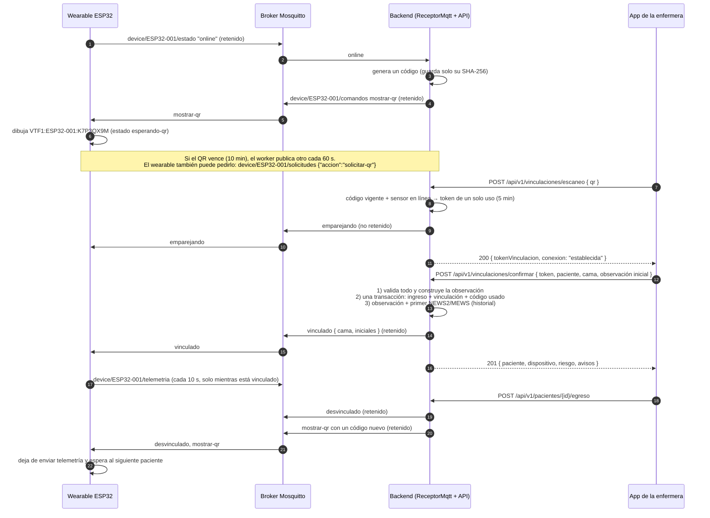

# Vinculación del wearable por QR (HU06 y HU09)

La enfermera vincula el wearable a un paciente escaneando el QR que muestra la OLED del sensor. En el mismo paso registra o elige al paciente, la cama y la toma inicial (oxígeno, conciencia y presión), y el backend calcula el primer NEWS2/MEWS.

El QR no lleva ningún dato del paciente. Vincular exige estar frente al sensor: el código solo lo muestra la pantalla y nunca sale por la API.

## Flujo completo



| Momento | Qué publica el backend en `device/{codigo}/comandos` |
|---|---|
| El wearable se conecta (`online`) y no está vinculado | `mostrar-qr` con un código nuevo |
| Se conecta y está vinculado (por ejemplo, tras reiniciarse) | `vinculado` otra vez |
| Se conecta mientras una enfermera tiene un escaneo en curso | `emparejando` (no se invalida su token) |
| Pide un QR (`solicitar-qr`) | igual que al conectarse |
| El QR venció y el sensor sigue en línea y sin vincular | `mostrar-qr` nuevo (worker, cada 60 s) |
| Escaneo válido | `emparejando` |
| Vinculación confirmada (por QR o por la vía manual de respaldo) | `vinculado` con cama e iniciales |
| Egreso o liberación del sensor | `desvinculado` y luego `mostrar-qr` nuevo |
| 5 códigos equivocados sobre el mismo sensor | `mostrar-qr` nuevo (el anterior queda invalidado) |

El JSON de cada comando y lo que debe hacer el firmware están en [`contrato-telemetria.md`](contrato-telemetria.md#comandos-al-wearable).

## Formato del QR

`VTF1:{codigoDispositivo}:{codigo}`, por ejemplo `VTF1:ESP32-001:K7P3QX9M`.

- `VTF1`: prefijo y versión del formato.
- `codigoDispositivo`: el código del sensor, el mismo del tópico MQTT.
- `codigo`: 8 caracteres aleatorios (`RandomNumberGenerator`) del alfabeto `23456789ABCDEFGHJKMNPQRSTUVWXYZ`. No incluye 0, 1, I, L ni O, para que no se confundan.

Todo va en mayúsculas para que el QR use el **modo alfanumérico**. Con el código de dispositivo más largo posible (32 caracteres) el texto tiene 46 caracteres y entra en la **versión 3 con corrección M** (29 × 29 módulos; capacidad de 61 caracteres alfanuméricos). En la OLED de 128 × 64 se dibuja a 2 píxeles por módulo (58 × 58 px).

## Seguridad

| Medida | Cómo |
|---|---|
| Un solo uso | Al confirmar, el código queda `usado_en`; el token de vinculación también deja de servir. Reutilizar un token responde 404 `vinculacion-no-valida` |
| Sin texto plano | En `vitalify.codigo_vinculacion` solo se guardan el SHA-256 del código (`hash_codigo`) y del token (`token_hash`). La comparación es en tiempo constante (`CryptographicOperations.FixedTimeEquals`) |
| Vencimiento | El código vale `Vinculacion__MinutosVigenciaCodigo` (10 min); el token, `Vinculacion__MinutosVigenciaToken` (5 min). Un escaneo en curso no se renueva hasta que vence su token |
| Un código activo por sensor | Índice único parcial `ux_codigo_vinculacion_activo` (sin usar ni invalidar). Generar uno nuevo invalida el anterior en la misma transacción |
| Intentos | Al 5.º código equivocado sobre el mismo sensor (`Vinculacion__IntentosMaximos`), su código se invalida y se publica uno nuevo. Además, `escaneo` admite 10 solicitudes por minuto por usuario (`RateLimit:EscaneoQrPorMinuto`) |
| Mismo error para todo | Un QR vencido, ya usado, inventado o con otro formato responde siempre el mismo 404 `qr-no-valido`: no se revela cuál fue el motivo. La auditoría sí lo guarda |
| Presencia del sensor | Escanear exige que el sensor esté en línea (`online` en `device/{codigo}/estado`); si no, 409 `sensor-sin-conexion` |
| Sin datos personales | Ni el QR, ni MQTT, ni la auditoría, ni el log llevan el nombre, el DNI ni el diagnóstico. Al wearable solo van la cama y las iniciales (`R.M.`) en `vinculado`. El log de comandos registra solo la acción y el dispositivo, nunca el contenido del QR |
| Auditoría | `QrGenerado`, `QrEscaneado`, `QrRechazado` (con el motivo) y `VinculacionPorQr`, solo con ids |
| Roles | Escanear y confirmar: `SoloEnfermera`. Regenerar un QR (`POST /dispositivos/{id}/qr`): administrador o personal clínico; no devuelve el código |

## Confirmar sin dejar nada a medias

El ingreso y la vinculación viven en la base transaccional; la observación y la evaluación, en el historial (dos `DbContext`). Por eso `ConfirmarVinculacion` sigue este orden:

1. **Validar:**
   - el token;
   - los datos del paciente, con las mismas reglas de `POST /pacientes`;
   - la cama y la toma inicial.

   La observación se **construye en el dominio** antes de guardar nada: si es inválida, responde 400 y no se guarda nada.
2. **Una transacción:** ingreso (o reutilización del paciente), asignación del sensor y código marcado como usado.
3. **Historial:** observación y primer NEWS2/MEWS. Si este paso falla, el paciente ya quedó vinculado. Se responde 201 con `avisos: ["La observación inicial no se guardó; regístrela de nuevo."]` y se registra en el log solo el id de la hospitalización.
4. Se invalida la caché del resolutor de dispositivos y se publica `vinculado`.

Los casos de uso existentes no se duplican: `RegistrarIngresoPaciente.PrepararAsync`, `VincularDispositivo.PrepararAsync` y `ServicioObservaciones` son la misma lógica que usan `POST /pacientes`, `POST /pacientes/{id}/dispositivo` y `POST /pacientes/{id}/observaciones`.

## Endpoints

| Método y ruta | Quién | Qué hace |
|---|---|---|
| `POST /api/v1/vinculaciones/escaneo` | Enfermera | `{ "qr": "..." }` → `{ tokenVinculacion, dispositivo: { id, codigo }, conexion: "establecida", expiraEn }` |
| `POST /api/v1/vinculaciones/confirmar` | Enfermera | Paciente (`pacienteId` o datos nuevos), `camaId`, `diagnosticoIngreso` y `observacionInicial` → 201 `{ paciente, dispositivo, riesgo, avisos }` |
| `POST /api/v1/dispositivos/{id}/qr` | Administrador o personal clínico | Genera y publica un QR nuevo. 409 si el sensor está vinculado, en mantenimiento o dado de baja |
| `POST /api/v1/pacientes/{id}/dispositivo` | Enfermera | Vinculación manual de respaldo (sin QR): también invalida el QR del sensor y publica `vinculado` |

En la observación inicial son obligatorios el oxígeno (sí/no), la conciencia (respuestas del asistente) y al menos una lectura de presión. La FR solo se pide si el sensor no tiene una vigente. El formato es el mismo de `POST /pacientes/{id}/observaciones` ([`motor-clinico.md`](motor-clinico.md#asistente-de-toma-manual)).

## Broker: cambio necesario en el ACL

El ACL ya deja al backend escribir en `device/+/comandos` y a cada wearable leer el suyo. Para `solicitar-qr` hacen falta dos líneas. El ACL de producción (`deploy/mosquitto/acl`) ya las tiene; al del broker de desarrollo (`IOT/tesis_V01/broker/acl`) todavía hay que agregárselas:

```
user vitalify-backend
topic read device/+/solicitudes      # nueva

pattern write device/%u/solicitudes  # nueva
```

Sin ellas, el broker descarta en silencio la solicitud del wearable. El resto del flujo funciona igual, porque el QR también llega al conectarse y lo renueva el worker.

## Configuración

| Variable | Por defecto | Qué es |
|---|---|---|
| `Vinculacion__MinutosVigenciaCodigo` | 10 | Vigencia del QR |
| `Vinculacion__MinutosVigenciaToken` | 5 | Tiempo para confirmar tras escanear |
| `Vinculacion__IntentosMaximos` | 5 | Códigos equivocados antes de invalidar el QR |
| `Vinculacion__SegundosRenovacion` | 60 | Intervalo del worker que renueva los QR vencidos (0 lo apaga) |
| `RateLimit:EscaneoQrPorMinuto` (appsettings) | 10 | Escaneos por minuto por usuario |

Con `Mqtt__Habilitado=false` los comandos no salen: el adaptador solo escribe en el log la acción y el dispositivo.

## Pruebas

- **Dominio:** generación y validación del código (alfabeto, largo, vencimiento, intentos, token), formato del QR e iniciales.
- **Integración:** `HU06VinculacionPorQrTests`, con los escenarios QR-E1 a QR-E7. El publicador real va envuelto en un grabador (`Fabrica.Comandos`) que verifica tópico, JSON y si es retenido.
- **Con Mosquitto real** (`IotMqttTests`): un cliente se suscribe a `device/ESP32-T01/comandos` y recibe, en orden:
  1. `mostrar-qr` (retenido) al publicar `online`;
  2. un QR nuevo con `solicitar-qr`;
  3. `emparejando` al escanear;
  4. `vinculado` al confirmar.
